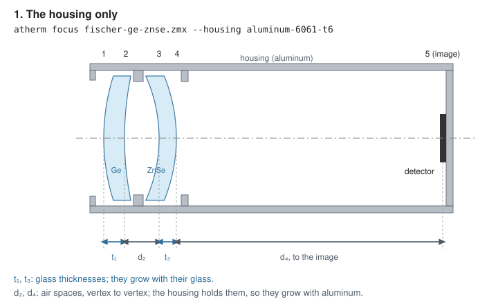
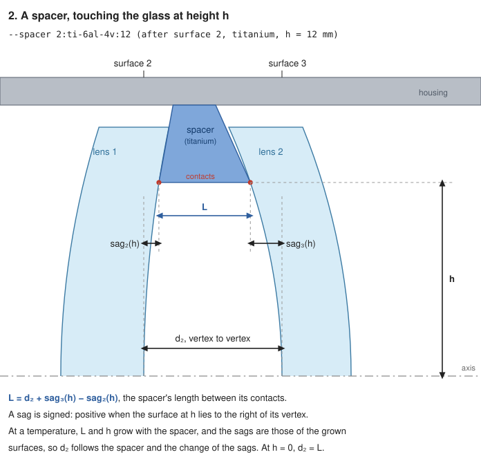
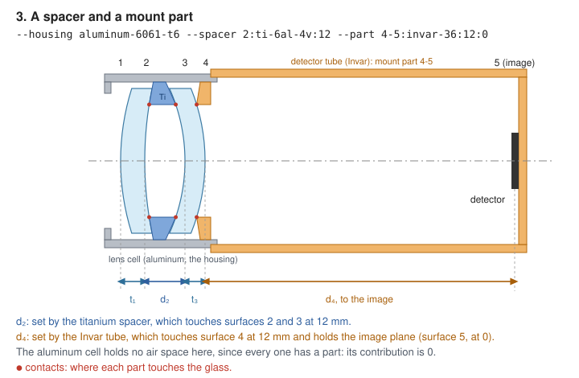
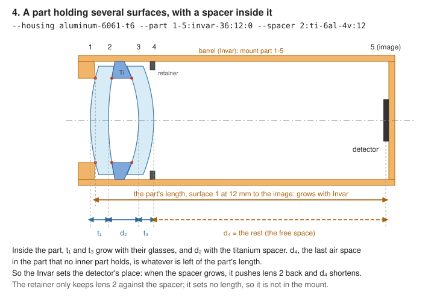

# Describing the mount

A lens file gives the glasses and the spacing between surfaces, but not what holds them: the barrel, the spacers, the tube that carries the detector. Over temperature that matters as much as the glass does. An air space grows with whatever part holds it, so the same lens drifts differently in an aluminum barrel than in an Invar one. This page shows how to tell the module what holds the lens, with a diagram for each kind of part, and how to keep it in a mount file.

The examples all use [`fischer-ge-znse.zmx`](../examples/fischer-ge-znse.zmx), an air-spaced germanium and ZnSe doublet for 8-12 µm. Its surfaces are numbered as in the lens file:

| Surface | What it is | The thickness after it |
|---|---|---|
| 1 | front of the germanium lens | t₁, germanium |
| 2 | back of the germanium lens | d₂, air, to lens 2 |
| 3 | front of the ZnSe lens | t₃, ZnSe |
| 4 | back of the ZnSe lens | d₄, air, to the image |
| 5 | the image plane | |

The diagrams are schematic: not to scale, with the curvatures exaggerated.

## The rules

1. **Glass thicknesses grow with their glass.** Nothing in the mount changes them.
2. **The housing holds every air space that no other part holds,** vertex to vertex, and the image plane at the last surface. With only a housing, every air space grows with it.
3. **A spacer or a mount part holds the air spaces you assign to it.** It grows with its own material, and it may touch the glass away from the axis.
4. **A mirror grows with its substrate**, given by `--mirror`. A mirror without one is taken to be of the housing's material.

To find a lens's surface numbers, run `atherm lens <file> --housing <any material> --detail`. Its surface table is numbered as the module counts, and the last surface is the image.

## 1. The housing only



```
atherm focus examples/fischer-ge-znse.zmx --housing aluminum-6061-t6
```

This is the usual starting model: the lenses sit on seats in one barrel, and the detector is mounted on the same barrel. Both air spaces, d₂ and d₄, grow with aluminum. Use it when the lens and the detector share one structure of one material, or when you don't know the mount yet.

The housing's material is any name from `atherm lens --mount-materials`, or a number: `--housing 23.6` is a material of α = 23.6×10⁻⁶/K.

## 2. A spacer



```
atherm focus examples/fischer-ge-znse.zmx --housing aluminum-6061-t6 --spacer 2:ti-6al-4v:12
```

A spacer fills one air space. `--spacer 2:ti-6al-4v:12` has three fields:
- `2`: the surface it follows. The ring sits in the air space after surface 2, between surfaces 2 and 3.
- `ti-6al-4v`: its material.
- `12`: **h, the height in mm at which the ring touches the glass**, measured from the optical axis outward, across the lens, not along the axis. It is the radius of the circle where the ring meets each surface: half the ring's contact diameter. A ring that touches the lenses on a 24 mm diameter has h = 12.

The spacer sets the axial distance between its two contact points, L in the diagram. Leave out the height, or give 0, and it holds the vertex distance on the axis instead.

At a temperature, h grows with the spacer, not with the barrel: the contact is the ring's own edge, and that circle grows with the ring. When the glass rests instead on a seat machined into the barrel, the barrel is the part touching it. Give that seat as a `--part` of the barrel's material, and its h grows with the barrel.

The height matters because the air space on the axis, d₂, is not the spacer's length L. The two differ by the surfaces' sags at the contact, L = d₂ + sag₃(h) − sag₂(h). At a temperature, the spacer grows, and so do the lenses and their sags, so d₂ changes by both. Give the real contact height for a spacer that touches steep surfaces near their edge.

Every other air space still grows with the housing: here d₄, to the image.

## 3. A part that holds the image plane



```
atherm focus examples/fischer-ge-znse.zmx --housing aluminum-6061-t6 --spacer 2:ti-6al-4v:12 --part 4-5:invar-36:12:0
```

`--part a-b:material:ha:hb` is a part that holds surface a to surface b: it touches surface a at height ha and surface b at height hb, both measured from the axis, as for a spacer. Here it is an Invar tube that seats on the back of lens 2, 12 mm from the axis, and carries the detector, surface 5, on the axis (0). A part can end at the image surface, which is how a detector mount that is not the housing is given.

A part that holds only the air space after one surface, touching both surfaces at the same height, is a spacer. `--part 2-3:ti-6al-4v:12:12` is the same as `--spacer 2:ti-6al-4v:12`.

In this mount every air space has its own part, so the aluminum cell holds none. Its contribution in the report is 0.

## 4. A part holding several surfaces



```
atherm focus examples/fischer-ge-znse.zmx --housing aluminum-6061-t6 --part 1-5:invar-36:12:0 --spacer 2:ti-6al-4v:12
```

Here one Invar barrel holds everything, from the seat on surface 1 to the detector. Inside it, lens 1 rests on the seat, the titanium spacer sets the gap to lens 2, and a retainer holds the stack together. The barrel fixes the distance from surface 1 to the image. Inside that length:
- the glass thicknesses grow with their glasses;
- an air space held by a part inside it, d₂ here, grows with that part;
- any other air space inside it grows with the housing, except one: the **free space**, the last air space in the part that no inner part holds. It takes up the rest of the part's length. Here it is d₄.

So when the spacer warms and grows, it pushes lens 2 back, and d₄ shortens to make room. The detector stays where the Invar puts it.

A retainer that only presses the glass against a seat or a spacer sets no length, so it is not part of the mount. Parts may nest, as the spacer does inside the barrel, but they may not overlap.

## What each mount does to this lens

The focus rate at 20 °C, from `atherm focus`:

| Mount | Focus µm/K | From the housing | From the mount parts |
|---|---|---|---|
| 1. Housing only, aluminum | −7.85 | −1.16 | |
| 2. Plus a titanium spacer at 12 mm | −7.81 | −1.09 | −0.05 |
| 3. Plus an Invar detector tube from surface 4 | −6.79 | 0 | −0.11 |
| 4. Invar barrel from surface 1, titanium spacer | −6.72 | 0 | −0.08 |

The germanium lens contributes −6.7 µm/K in every case, and the mount can only remove the −1.2 that comes from the housing. This lens needs other materials, not another mount ([the user guide](user-guide.md#searching-for-materials-an-athermal-triplet-for-8-12-µm) shows the search). In a lens whose glasses nearly cancel, such as the visible doublet in the [user guide](user-guide.md#focus-how-far-the-focus-moves-and-why), the mount is most of the drift, and choosing it is the fix.

## Checking a mount

Two outputs show what the module made of your mount.

**`atherm lens --detail`** says, in its last column, what each surface grew with and what set the thickness after it. For mount 3 at 60 °C:

```
  surf        radius mm     thickness mm  ...   shape grows with / thickness set by
     1        55.173845         3.127458  ...   MISC:GERMANIUM / MISC:GERMANIUM
     2        84.182224         2.792631  ...   MISC:GERMANIUM / mount part 2-3, ti-6al-4v
     3       -41.497602         2.540721  ...   MISC:ZNSE / MISC:ZNSE
     4       -42.828940        46.261300  ...   MISC:ZNSE / mount part 4-5, invar-36
     5         infinity         0.000000  ...   image
```

**`atherm focus`** lists each part's contribution to the focus rate, the housing and each spacer and mount part among them. A part you meant to hold an air space but whose contribution is 0 is holding nothing. The first line of every report also restates the mount:

```
Mount: housing, aluminum-6061-t6 (α 23.6×10⁻⁶/K); spacer after surface 2, ti-6al-4v (α 8.6×10⁻⁶/K), touching at 12 mm; part from surface 4 to 5, invar-36 (α 1.3×10⁻⁶/K), touching surface 4 at 12 mm and surface 5 at 0 mm.
```

If a part is shorter than what it holds, so that its free space would turn negative, the output says so.

## Describing your own lens, step by step

1. **Number the surfaces.** Run `atherm lens <file> --housing aluminum-6061-t6 --detail` and read the surface table.
2. **Go through the air spaces one by one.** For each, ask what physical part sets that distance: a seat machined into the barrel, a spacer ring, a separate cell or tube.
3. **Choose the housing.** It is the structure that holds every air space you don't assign to another part, usually the main barrel. If the detector sits on the same structure, the housing holds the image plane too.
4. **Add the other parts.** A ring between two lenses is a `--spacer`. A tube or cell that spans several surfaces, or that carries the detector, is a `--part`, ending at the image surface if it holds the detector.
5. **Give the contact heights.** Where a spacer or seat touches the glass away from the axis, give that height in mm. A seat on a flat or nearly flat face, or the image plane, is 0.
6. **Give the mirror substrates,** if there are mirrors: `--mirror 4:aluminum-6061-t6`.
7. **Check it** with `--detail` and the contributions, as above.
8. **Save it** with `--save-mount`, so that later runs read it from the mount file.

## The mount file

`--save-mount` writes the mount beside the lens, `fischer-ge-znse.mount.json` beside `fischer-ge-znse.zmx`, and later runs of `lens`, `focus`, `image` and `select` read it. Options on the command line override it ([the user guide](user-guide.md#keeping-the-mount-the-mount-file) has the rules). Mount 3, as `--save-mount` writes it:

```json
{
  "format": "athermalize-mount",
  "version": 1,
  "nominalTemperatureC": 20,
  "pressureAtm": 1,
  "housing": "aluminum-6061-t6",
  "spacers": [
    { "after": 2, "material": "ti-6al-4v", "height": 12 }
  ],
  "parts": [
    { "from": 4, "to": 5, "material": "invar-36", "fromHeight": 12, "toHeight": 0 }
  ],
  "cemented": "following"
}
```

Mount 4 has the barrel as a part from surface 1 to the image, with the spacer inside it:

```json
{
  "format": "athermalize-mount",
  "version": 1,
  "housing": "aluminum-6061-t6",
  "spacers": [ { "after": 2, "material": "ti-6al-4v", "height": 12 } ],
  "parts": [ { "from": 1, "to": 5, "material": "invar-36", "fromHeight": 12, "toHeight": 0 } ]
}
```

The file can be written by hand. Comments are allowed, and any field may be left out:

| Field | Meaning | Command-line option |
|---|---|---|
| `format`, `version` | `"athermalize-mount"` and 1 | |
| `nominalTemperatureC` | the temperature the design is for, °C (20) | `--nominal` |
| `pressureAtm` | the air pressure the design is for, atm; 0 is vacuum (1) | `--pressure` |
| `housing` | the housing's material | `--housing` |
| `spacers` | each `after` a surface, with a `material` and a contact `height` in mm (0) | `--spacer s:material:h` |
| `parts` | each `from` one surface `to` another, with a `material`, `fromHeight` and `toHeight` in mm (0) | `--part a-b:material:ha:hb` |
| `mirrors` | a substrate material for each mirror, by surface: `{ "4": "aluminum-6061-t6" }` | `--mirror s:material` |
| `cemented` | which glass a cemented surface grows with: `"following"` (the default) or `"preceding"` | `--cemented` |
| `use` | a material in place of one the lens file names: `{ "GERMANIUM": "JPCRD:GE" }` | `--use` |
| `cte` | an expansion coefficient, 10⁻⁶/K, in place of the data's: `{ "N-BK7": 7.2 }` | `--cte` |

A material is a name from `atherm lens --mount-materials` or a number, α in 10⁻⁶/K. The file doesn't keep the temperatures to analyze or the index conventions, since those are choices of each run.

## Mirrors

A mirror's surface grows with its substrate, so a mirror's radius changes with the substrate's expansion, not the housing's. The [Cassegrain example](user-guide.md#a-visible-cassegrain-in-space) has ULE mirrors in a structure of 1.5×10⁻⁶/K:

```
atherm focus examples/itek-cassegrain.zmx --housing 1.5 --mirror 3:0.03 --mirror 4:0.03 --nominal 7.5 --pressure 0
```

The structure holds the spacing between the mirrors and the image plane, as any housing does.

## How it is computed

[lens-at-temperature.md](lens-at-temperature.md#air-spaces-the-mount) gives the model in full, with its sources: how each part's length is measured between its contacts, how the sags enter, and how nested parts are resolved.
