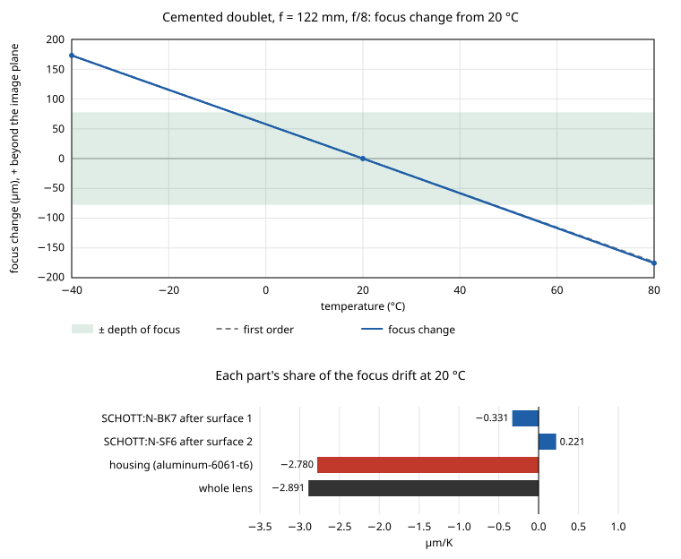
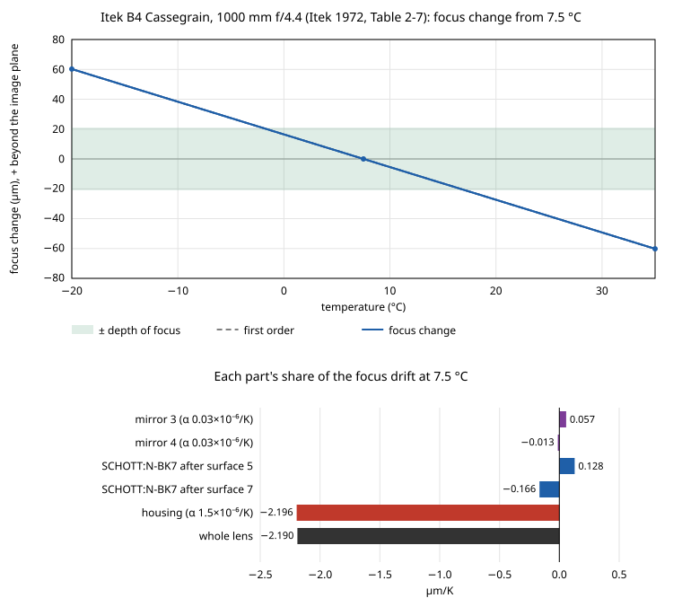
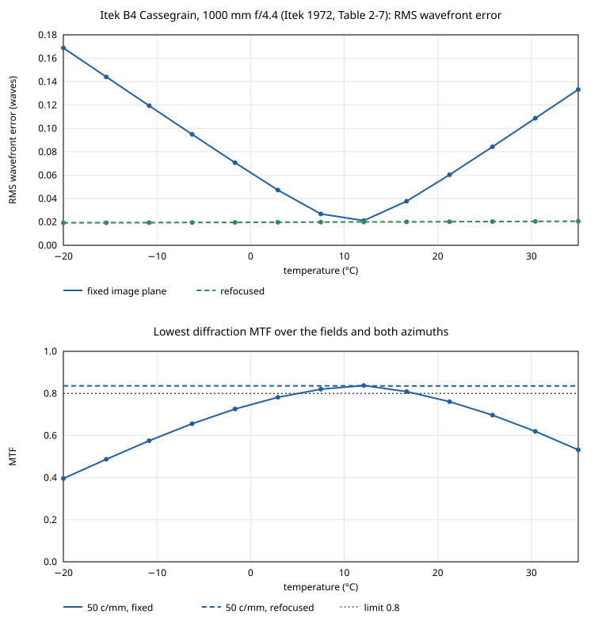
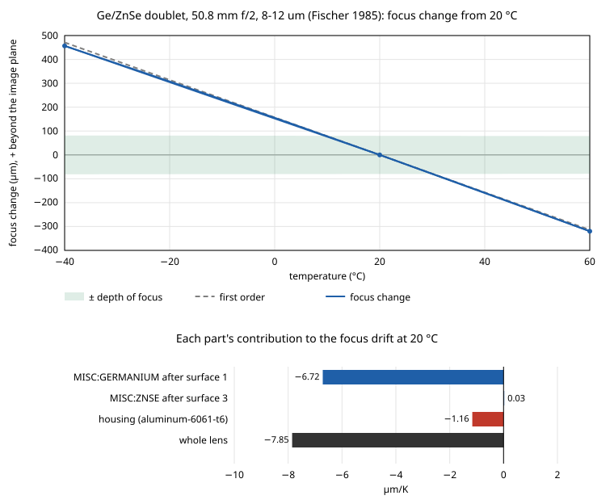
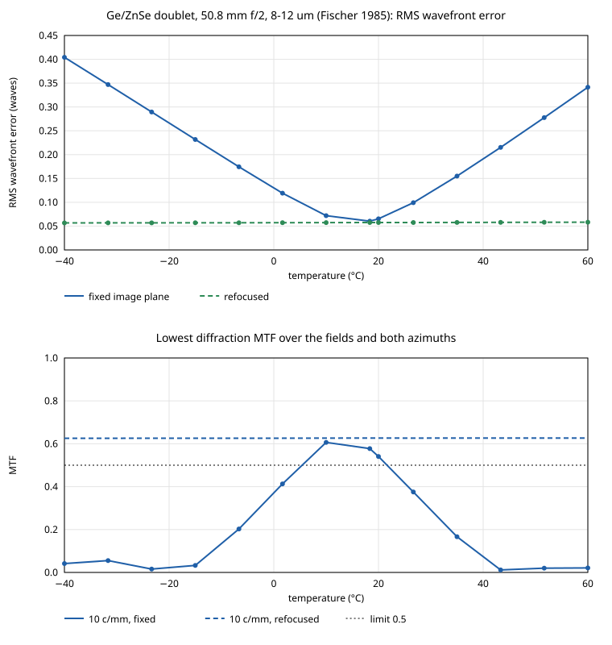

# User guide

AthermalizeModule is a .NET library and a command-line tool, `atherm`, for the thermal analysis of lenses. This guide shows the tool first, then the library.

## Getting started

Build it, or publish an `atherm` to use anywhere, as [building.md](building.md) shows. From the repository, `dotnet run --project src/Athermalize.Cli -- <command>` runs it without publishing; the examples below write `atherm` for either.

Three commands to start with, all from the repository's root:

```
atherm materials N-BK7 --temperatures -40,20,80
atherm focus examples/doublet.zmx --housing aluminum-6061-t6 --temperatures -40,20,80
atherm map N-BK7 N-SF6 --housing aluminum-6061-t6
```

The first prints N-BK7's index, dn/dT and x_f at three temperatures; the second, how far a cemented doublet's focus moves in an aluminum housing, and which part moves it; the third, where the two glasses and the housing fall on the athermal map. Temperatures are in °C, lengths in mm, wavelengths in µm, and expansion coefficients in 10⁻⁶/K unless an option says otherwise.

## The commands

| Command | What it gives |
|---|---|
| `atherm materials <name>...` | A material's index, dn/dT and x_f over temperature ([materials.md](materials.md)) |
| `atherm lens <file>` | The lens at each temperature, paraxially, and with `--detail` its prescription |
| `atherm focus <file>` | The first-order report: focus against the depth of focus, and each part's contribution |
| `atherm image <file>` | RMS wavefront error and diffraction MTF, at the fixed image plane and refocused |
| `atherm map <material>...` | The athermal map: each material's ν, ω, γ and x_f over a band, the housing's point, and an SVG plot |
| `atherm solve <a> <b> [<c>]` | The thin athermal achromatic doublet or triplet; `--partners` ranks a glass's best partners |
| `atherm select <file>` | Every combination of candidate glasses and mount materials, scored on the lens |

`atherm --help` lists every option. A lens file is any format AberrationCalculator reads (.zmx, .seq, .otx, .len, .json, .lhlt), in millimeters, with its glasses in the .AGF catalogs next to `atherm` or in `--catalogs`.

### Materials

A material is named as `CATALOG:NAME` (`SCHOTT:N-BK7`) or by its name alone (`N-BK7`), which finds it in the first catalog that has it. Besides the catalog glasses, the module carries:

- **Measured materials**, fitted to measurements over temperature: `CHARMS:SI`, `CHARMS:GE`, `CHARMS:CAF2`, `CHARMS:INFRASIL_301` and `CHARMS:FS_7980`, from 20-35 K to 300 K, for cold lenses; and `JPCRD:GE`, `JPCRD:ZNS` and `JPCRD:ZNSE`, to about 550-620 K, for the long-wave infrared and warm lenses.
- **Glasses from makers' data sheets**: SCHOTT's chalcogenides `IRG22`, `IRG25`, `IRG26` and `IRG27`.

`atherm materials --measured` lists them with their ranges and sources; [materials.md](materials.md) says which to use where. A result outside a material's wavelength or temperature range is marked, never silently extrapolated. In a lens, `--use GERMANIUM=JPCRD:GE` takes a measured material in place of the one the file names.

**Conventions.** Where published implementations of SCHOTT's thermal model differ, the choice is an option with a default ([materials.md](materials.md#conventions)): `--prefactor`, `--thermal-wavelength`, `--lambda-tk-sign` and `--air-wavelength`. The defaults follow the makers' data sheets and the common practice with their catalogs. To match another program, set its choices; for Optiland, `--prefactor absolute --thermal-wavelength system --lambda-tk-sign ignore`. `--air ciddor --humidity 50` uses Ciddor's air with humidity instead of TIE-19's dry air.

### Describing the mount

At a temperature, each glass element grows as a whole by 1 + αΔT with its own α: its radii, its center thickness and its diameter, with its conic unchanged. The air spaces are set by the mount. [lens-at-temperature.md](lens-at-temperature.md#in-short) has a table of what changes and an example; `atherm lens --detail` prints the prescription at each temperature.

Every lens command needs at least the housing:

```
atherm focus lens.zmx --housing aluminum-6061-t6
```

- `--housing` holds every air space and the image plane, vertex to vertex.
- `--spacer 3:titanium:9` puts a spacer in the air space after surface 3, touching both surfaces 9 mm off the axis.
- `--part 1-5:invar-36` holds surface 1 to surface 5 with a part of Invar; the last air space inside it takes up the rest. `--part 6-9:stainless-303` with surface 9 the image holds the image plane from surface 6.
- `--mirror 4:23` gives the mirror at surface 4 a substrate of α = 23×10⁻⁶/K.
- A material is a name from `atherm lens --mount-materials`, or a number, α in 10⁻⁶/K. The `-cryo` materials (`aluminum-6061-t6-cryo`, `stainless-304-cryo`, `ti-6al-4v-cryo`, `invar-36-cryo`) carry their length from 4 to 300 K, from NIST's cryogenic fits, for a lens that works cold.

`--use CAF2=CHARMS:CAF2` uses another material in place of one the file names, and `--cte N-BK7=7.1` another expansion coefficient. The design's temperature is `--nominal` (20 °C), and the air pressure `--pressure` (1 atm; 0 is vacuum). The index conventions are the options of `atherm materials`.

### The lens at new conditions: indices and prescription

`--nominal` and `--pressure` give the conditions the design is for: 20 °C and 1 atm unless the mount file or the options say otherwise. The temperatures to analyze are `--temperatures`, and `--at-pressure` the pressure there when it differs, 0 for vacuum. `atherm lens --detail` then lists, first at the design's conditions and then at each temperature:
- the wavelengths, in that air and in vacuum;
- the air's absolute index at each wavelength;
- each material's index relative to that air, and its absolute index;
- surface by surface, the radius, the thickness and the relative index at each wavelength.

A lens designed in air at 20 °C and used in vacuum at −40 °C:

```
atherm lens examples/doublet.zmx --housing aluminum-6061-t6 --nominal 20 --pressure 1 --temperatures -40 --at-pressure 0 --detail
...
At -40 °C in vacuum:
  wavelength in this air, µm             0.587722     0.486266     0.656451
  wavelength in vacuum, µm               0.587722     0.486266     0.656451
  air, absolute index                  1.00000000   1.00000000   1.00000000
  SCHOTT:N-BK7, relative                1.5171546    1.5227181    1.5146820
  SCHOTT:N-BK7, absolute                1.5171546    1.5227181    1.5146820
  SCHOTT:N-SF6, relative                1.8057479    1.8283149    1.7966730
  SCHOTT:N-SF6, absolute                1.8057479    1.8283149    1.7966730

  surf        radius mm     thickness mm  n_rel 0.5877  n_rel 0.4863  n_rel 0.6565   shape grows with / thickness set by
     1        72.098273         5.997444     1.5171546     1.5227181     1.5146820   SCHOTT:N-BK7 / SCHOTT:N-BK7
     2       -79.325998         2.498646     1.8057479     1.8283149     1.7966730   SCHOTT:N-SF6 / SCHOTT:N-SF6
     3      -170.505570       117.615221     1.0000000     1.0000000     1.0000000   SCHOTT:N-SF6 / housing aluminum-6061-t6
     4         infinity         0.000000     1.0000000     1.0000000     1.0000000   image
```

[`doublet-vacuum-detail.txt`](../examples/doublet-vacuum-detail.txt) has the whole output, the design's block at 20 °C and 1 atm first, where the air's absolute index is 1.00027242 at 0.5876 µm. In vacuum each relative index is the absolute one, and the wavelengths in "air" are the vacuum ones.

`--at-pressure` works with `focus` and `image` too. There, the first-order change at the design's temperature is the step the new air alone makes, −110 µm for this doublet put in vacuum, more than a depth of focus, and the rates are those in the new air: in vacuum the air's own dn/dT drops out.

**Taking it to another program.** `--write <file>` writes the lens at one temperature and air, its geometry grown and its glasses frozen into a catalog beside it, so that another program traces exactly this lens at its default 20 °C and 1 atm, with nothing to set. [other-programs.md](other-programs.md) explains why that is valid and how to use it, and why the relative index is all a ray trace needs:

```
atherm lens examples/doublet.zmx --housing aluminum-6061-t6 --temperatures -40 --at-pressure 0 --write doublet-cold-vacuum.zmx
```

### Keeping the mount: the mount file

A lens file says nothing about its housing, so the mount is kept in a file of its own beside the lens: `doublet.mount.json` beside `doublet.zmx`. Lens files are left as they are; only `atherm` reads and writes the mount file.

- **Saving.** `--save-mount` on `lens`, `focus` or `image` writes the mount and the design's conditions as the run used them. On `select` it writes the best combination's housing and mount parts; the glasses it chose are not saved, since a glass swap changes the lens, and the lens file holds that.
- **Using.** `lens`, `focus`, `image` and `select` read the mount file beside the lens when there is one, and say so in their output. `--mount <file>` names another; `--no-mount` ignores it.
- **Overriding.** Options given on the command line win, and the output says they did. `--housing`, `--nominal`, `--pressure` and `--cemented` replace the file's; any `--spacer` or `--part` replaces all of its spacers and parts; `--mirror`, `--use` and `--cte` replace its entries for the same surface or material and keep the rest.

```
atherm focus doublet.zmx --housing ti-6al-4v --spacer 3:invar-36:9 --save-mount
atherm image doublet.zmx --frequencies 30          # the same mount, from doublet.mount.json
```

The file is plain JSON, to edit by hand and keep with the lens. A material is a name from `--mount-materials` or a number, α in 10⁻⁶/K; comments are allowed, and any field may be left out:

```json
{
  "format": "athermalize-mount",
  "version": 1,
  "nominalTemperatureC": 20,
  "pressureAtm": 1,
  "housing": "ti-6al-4v",
  "spacers": [ { "after": 3, "material": "invar-36", "height": 9 } ],
  "parts": [ { "from": 1, "to": 4, "material": 22.5, "fromHeight": 0, "toHeight": 0 } ],
  "mirrors": { "6": "aluminum-6061-t6" },
  "cemented": "following",
  "use": { "GERMANIUM": "JPCRD:GE" },
  "cte": { "N-BK7": 7.2 }
}
```

The file doesn't keep the index conventions or the temperatures to analyze: those are choices of each run, not of the lens.

### Expansion over temperature

Most materials grow by one expansion coefficient: a catalog glass by its `ED` line's mean from −30 to +70 °C, a mount metal by its mean near room temperature. Some carry their length over temperature instead, and grow by it ([lens-at-temperature.md](lens-at-temperature.md)):

- `CHARMS:SI`, `CHARMS:GE`, `JPCRD:GE`, `CHARMS:CAF2`, `JPCRD:ZNS` and `JPCRD:ZNSE`;
- the `-cryo` mount metals, from 4 to 300 K.

This matters most for a lens that works cold. Cooled from 20 °C to 77 K, silicon shrinks 230×10⁻⁶ where its coefficient at 20 °C would give 552×10⁻⁶, and 6061 aluminum 0.39 % where its room-temperature mean would give 0.51 %. For a lens soaked to 77 K, use the measured crystals and the `-cryo` metals:

```
atherm focus cold.zmx --use SILICON=CHARMS:SI --housing aluminum-6061-t6-cryo --temperatures 20,-196 --pressure 0
```

When a temperature is outside a material's expansion data, the output says its length is extrapolated. `--cte` replaces a material's curve with one coefficient.

### Reading the reports

The examples in [`../examples`](../examples) are a cemented doublet of 122 mm focal length at f/8 in an aluminum housing.

`atherm focus` gives, at each temperature:
- the focal length and back focal length;
- the change of focus, beside the first-order rate times ΔT;
- the change in depths of focus.

It then gives each part's contribution to the rates, and the glasses' x_f, γ and ν_T. In [`doublet-focus.txt`](../examples/doublet-focus.txt) the glasses nearly cancel, and the housing's growth, −2.78 µm/K, is most of the −2.89 µm/K total. Over ±60 K that is ±2.2 depths of focus.

`atherm image` gives the RMS wavefront error at the fixed image plane and refocused, and how far the plane must move. It gives the diffraction MTF at `--frequencies` both ways, and with `--mtf-limit` the temperatures over which the lowest MTF stays above the limit. In [`doublet-image.txt`](../examples/doublet-image.txt):
- refocusing holds the RMS at 0.078 waves from −40 to +80 °C;
- the diffraction MTF at 30 cycles/mm stays above 0.5 from −27.9 to +50.9 °C at the fixed image plane.

`--mtf geometric` gives the geometric MTF instead: 0.924 on axis at 30 cycles/mm for this lens, against the diffraction MTF's 0.769. `--grid` sets the diffraction MTF's pupil grid (64). A range search over two fields and three wavelengths takes about a minute; `--monochromatic` or fewer fields make it quicker.

**Plots.** `--svg <file>` adds a plot to `focus` and `image`, an SVG file that a browser opens and a document takes as an image:
- `focus` plots the focus change against temperature, finely sampled, beside the first-order line and the ±depth of focus band. Below it, each part's contribution to the drift is a bar.
- `image` plots the RMS wavefront error, and the lowest MTF at each frequency over the fields and both azimuths, against temperature, at the fixed image plane (solid) and refocused (dashed), with the `--mtf-limit` line. It computes the image at `--plot-points` temperatures (13) evenly over the span of `--temperatures`, so it takes about that many times as long as one temperature. The report's own temperatures are among them.



[`doublet-image.svg`](../examples/doublet-image.svg) is the doublet's image plot.

### Two lenses from the literature

Two published designs are in [`../examples`](../examples), each with its mount file, so each runs with no mount options. Both lens files match their sources' first-order data (`ExampleLensTests`).

**A visible Cassegrain in space.** [`itek-cassegrain.zmx`](../examples/itek-cassegrain.zmx) is the B4 Cassegrain of Itek Corporation's 1972 study for the Jet Propulsion Laboratory: 1000 mm at f/4.4, two aspheric mirrors and two BK7 correctors, at 0.55 µm. Its mount file, [`itek-cassegrain.mount.json`](../examples/itek-cassegrain.mount.json), is one of the report's cases: a structure of 1.5×10⁻⁶/K, ULE mirrors of 0.03×10⁻⁶/K, designed for 7.5 °C in vacuum. It was written by the first run:

```
atherm focus examples/itek-cassegrain.zmx --housing 1.5 --mirror 3:0.03 --mirror 4:0.03 --nominal 7.5 --pressure 0 --temperatures -20,7.5,35 --save-mount --svg examples/itek-focus.svg
atherm image examples/itek-cassegrain.zmx --temperatures -20,7.5,35 --obscuration 0.52 --monochromatic --frequencies 50 --mtf-limit 0.8 --range -20,35 --svg examples/itek-image.svg
```

- In [`itek-focus.txt`](../examples/itek-focus.txt) the focus moves −2.19 µm/K, nearly all of it the structure's growth. The two correctors nearly cancel, and the mirrors barely move it.
- Warmed by 27.5 °C, the focus moves −60.2 µm, 2.9 depths of focus. The report gives −0.0023 in, −58 µm; [verification.md](verification.md) §6 compares its other cases.
- In [`itek-image.txt`](../examples/itek-image.txt), with the 0.52 central obstruction, refocusing holds the RMS wavefront error near 0.02 waves from −20 to 35 °C. At the fixed image plane the MTF at 50 cycles/mm stays above 0.8 only from 5.2 to 17.6 °C.





**A germanium doublet for 8-12 µm.** [`fischer-ge-znse.zmx`](../examples/fischer-ge-znse.zmx) is one of the infrared doublets Fischer (1985) gives: germanium then ZnSe, 50.8 mm at f/2, ±2.5°, at 8, 10 and 12 µm. Its mount file holds an aluminum housing:

```
atherm focus examples/fischer-ge-znse.zmx --housing aluminum-6061-t6 --temperatures -40,20,60 --save-mount --svg examples/fischer-focus.svg
atherm image examples/fischer-ge-znse.zmx --temperatures -40,20,60 --frequencies 10 --mtf-limit 0.5 --range -60,100 --svg examples/fischer-image.svg
```

- In [`fischer-focus.txt`](../examples/fischer-focus.txt) the focus moves −7.85 µm/K: −6.72 from the germanium, whose index rises 408×10⁻⁶/K, −1.16 from the housing, and almost nothing from the ZnSe. That is 5.6 depths of focus at −40 °C and 4.0 at 60 °C.
- Canceling it with the housing alone would take an expansion coefficient near −136×10⁻⁶/K, which no metal has. Such a lens is refocused, or its materials are changed, as the next part shows.
- In [`fischer-image.txt`](../examples/fischer-image.txt), the MTF at 10 cycles/mm stays above 0.5 at the fixed image plane only from 5.2 to 21.7 °C. Refocused, it stays above 0.5 from −60 to 100 °C, with the RMS near 0.06 waves.
- `--use GERMANIUM=JPCRD:GE --use ZNSE=JPCRD:ZNSE` runs it on Li's evaluated data instead of the catalog's fits: −7.96 µm/K, 1.4% more.





Neither source gives the image plane at the design temperature at the least RMS, so at the nominal temperature `atherm image` still moves the plane a little: 7 µm for the Cassegrain, −33 µm for the doublet.

**Searching for materials: an athermal triplet for 8-12 µm.** Swapping the doublet's materials doesn't fix it. `atherm select` tries ZnSe, ZnS and four of SCHOTT's IRG glasses for the second element, in four housings:

```
atherm select examples/fischer-ge-znse.zmx --glass 3:ZNSE,JPCRD:ZNS,SCHOTT_IRG:IRG22,SCHOTT_IRG:IRG25,SCHOTT_IRG:IRG26,SCHOTT_IRG:IRG27 --housing-candidates aluminum-6061-t6,stainless-303,ti-6al-4v,invar-36 --keep 6
```

In [`fischer-select.txt`](../examples/fischer-select.txt) the best of the 24 combinations, ZnS in an Invar housing, still drifts −6.77 µm/K. `select` keeps the design's shapes, and the germanium element carries nearly all the power, so nearly all the drift stays. The powers have to change, which is what `atherm solve` does with thin lenses:

```
atherm solve GERMANIUM --partners --catalog SCHOTT_IRG --band lwir --housing aluminum-6061-t6 --focal 50.8 --top 4
atherm solve GERMANIUM SCHOTT_IRG:IRG26 SCHOTT_IRG:IRG27 --band lwir --housing aluminum-6061-t6 --focal 50.8
```

In [`solve-lwir-triplet.txt`](../examples/solve-lwir-triplet.txt):
- **No germanium doublet works.** Every achromat of germanium and an IRG glass still drifts −8.3 to −9.5 µm/K in aluminum. Two materials can correct the color or the drift, not both, unless their points and the housing's lie on one line on the map, and none of these do.
- **Three materials do.** Germanium, IRG26 and IRG27 make an athermal achromatic triplet of 50.8 mm: germanium −205 mm, IRG26 29.0 mm and IRG27 −100 mm. Germanium becomes a weak negative corrector. IRG26, whose index barely changes with temperature (γ −1.9×10⁻⁶/K), carries the power.
- **It holds in the full model.** Built as three thin lenses in contact and run through the full model, the triplet has no axial color from 8 to 12 µm, and its focus drift rounds to 0.0000 µm/K, against −7.85 for Fischer's doublet (`AthermalTests`).
- **It is a starting point.** The powers are for thin lenses in contact. Give the elements thickness and spacing, and optimize the lens for its aberrations; then run `atherm focus` on it to see how far it has moved from athermal.

### Choosing materials

- **The map.** `atherm map N-PK51 N-BK7 N-SF6 --housing aluminum-6061-t6 --svg map.svg`, or `--catalog SCHOTT` for every glass of a catalog with thermal data. `--band mwir` or `lwir` takes 3, 4 and 5 µm or 8, 10 and 12 µm, or give three wavelengths. A doublet is athermal and achromatic when its two points and the housing's point lie on one line. [`map-visible.txt`](../examples/map-visible.txt) and [`map-visible.svg`](../examples/map-visible.svg) are twelve glasses and an aluminum housing; [`map-lwir.txt`](../examples/map-lwir.txt) and [`map-lwir.svg`](../examples/map-lwir.svg) are germanium, ZnSe, ZnS and SCHOTT's IRG glasses over 8-12 µm.
- **Solving.**
  - `atherm solve N-BK7 N-SF6 --housing aluminum-6061-t6 --focal 122` gives the achromat's powers, and how far it is from athermal.
  - Three materials give the athermal achromatic triplet: [`solve-triplet.txt`](../examples/solve-triplet.txt) is N-PK51, N-KZFS5 and N-LAK7.  [`solve-lwir-triplet.txt`](../examples/solve-lwir-triplet.txt) is germanium, IRG26 and IRG27 over 8-12 µm, above.
  - `--partners --catalog SCHOTT` lists the glasses that make the most nearly athermal achromat with one.
- **Searching.** `atherm select lens.zmx --housing aluminum-6061-t6 --near 2:0.08:6 --catalog SCHOTT --housing-candidates aluminum-6061-t6,stainless-303,ti-6al-4v` tries each SCHOTT glass within 0.08 in n_d and 6 in ν_d of the glass after surface 2, in each housing.
  - `--glass 2:N-SF6,SF6,N-SF57` gives a list, and `--part-candidates 0:aluminum-6061-t6,invar-36` the candidates for a mount part.
  - In [`doublet-select.txt`](../examples/doublet-select.txt), a titanium housing with SF6G05 or SF6 for the flint cuts the doublet's focus drift from −2.89 to about −0.26 µm/K.
  - The ranking is at the design's shapes; optimize the lens with the new materials before relying on it.

## The library

```csharp
using AberrationCalculator.Core.IO;
using Athermalize.Core.Analysis;
using Athermalize.Core.Lens;
using Athermalize.Core.Materials;

var library = MaterialLibrary.FromFolder("catalogs/Glass");
var lens = LensFile.Read("doublet.zmx", library.Glasses);
var mount = new Mount(MountMaterials.Find("aluminum-6061-t6")!,
    new[] { MountSegment.Spacer(3, MountMaterials.Find("ti-6al-4v")!, height: 9.0) });
var model = new ThermalModel(lens, library, mount);

ThermalLens hot = model.At(60.0);                 // its own OpticalSystem, and an index table per wavelength
var report = FocusReport.Compute(model, new[] { -20.0, 20.0, 60.0 });
var image = ImageQuality.Compute(model, new[] { -20.0, 20.0, 60.0 }, frequencies: new[] { 30.0 });
```

- `ThermalModel.At(t)` builds the lens at a temperature. It is a copy of AberrationCalculator's `OpticalSystem` with `Indices[w]`, the index after each surface at each wavelength, so any AberrationCalculator analysis runs on it: `ParaxialTrace.Trace(hot.System, hot.PrimaryIndices, field)`.
- `ThermalModel.At(air, part => ...)` builds it with only some parts warmed; this is how the report finds each part's contribution.
- `MountFile.Read(MountFile.PathFor("doublet.zmx")).ToMount()` gives the mount kept beside a lens, and `MountFile.From(mount, nominal, pressure).Write(path)` keeps one.
- `ImageQuality.Model(hot)` gives WavefrontErrorCalculator's `LensModel` of the lens at the temperature, for any of its analyses.
- `MaterialConstants.Of(material, Band.Visible)` gives ω, ν, P, γ and x_f; `Athermal.Doublet`, `Athermal.Triplet`, `Athermal.CanAthermalize` and `JiangObjective` work on them; `MaterialSearch.Run` searches a lens.
- `Material` and its kinds give the index directly: `Tie19Material` for catalog and data-sheet glasses, `MeasuredMaterial` for the CHARMS and JPCRD models, and `LinearMaterial` for a material known by its index, one dn/dT and α. `material.Index(λ, air, t, options)` takes the conventions as an `IndexOptions`, and `ThermoOptic.At(material, λ, t)` gives dn/dT and x_f.
- `material.Expansion.Growth` is the length over temperature it grows by, an `ExpansionCurve`: `Scale(from, to)` is the factor a length grows by, and `Alpha(t)` the coefficient there. A mount material made with `MountMaterial.OfCurve(name, curve, source)` grows by a curve of your own, such as a `TabulatedExpansion` of a measured table.

```csharp
var si = library.Find("CHARMS:SI")!;
double shrink = si.Expansion.Growth.Scale(20.0, -196.0) - 1.0;    // -230e-6, by Swenson's table
var o = IndexOptions.Default with { Prefactor = Prefactor.Absolute };
double n = si.Index(4.0, AirConditions.Vacuum(-196.0), -196.0, o).Relative;
```
