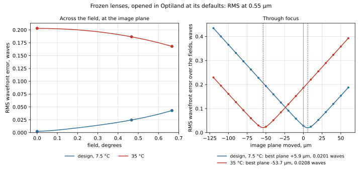

# User guide

AthermalizeModule is a .NET library and a command-line tool, `atherm`, for the thermal analysis of lenses. This guide starts with what the module is for and how its commands fit together. Then it takes each command in turn: why you would use it, what it computes, and how to read its output. The library comes last.

## What the module is for

A lens is designed at one temperature, usually 20 °C, but it is used over a range, often −40 to +70 °C or wider. When the temperature changes:

- **the glasses change:** each element grows with its own expansion coefficient, and its index changes with its dn/dT;
- **the mount changes:** the housing and the spacers grow, which moves the elements and the image plane;
- **the air changes:** its index changes with temperature and pressure, and a lens designed in air may be used in vacuum.

The focus moves, and the image at the detector blurs. When the focus moves less than the depth of focus over the whole range, the lens is *athermal*. The module answers four questions about a lens:

1. **How much does the focus move, and is it within the depth of focus?** (`focus`)
2. **What does that do to the image: the wavefront error and the MTF?** (`image`)
3. **Which part moves it: which glass, the housing, a spacer?** (`focus`, each part's contribution)
4. **Which materials and mount would hold the focus?** (`map`, `solve`, `select`)

It also gives the data behind the answers: a material's index over temperature (`materials`), and the lens itself at each temperature, surface by surface (`lens`). It can also write that lens out, so another program traces it unchanged.

## Why another thermal analysis

A lens that drifts out of focus over temperature is often found late, in a thermal chamber, when a measurement disagrees with the simulation. Then the question is whether the simulation can be trusted. Answering it means knowing exactly what the model did: which thermal model of the glass it used, whether the index was taken relative to air or to vacuum and at what temperature, how the air spaces grew and with which material, and which expansion coefficient each part got. Published implementations of the same glass model differ in several of these choices ([materials.md](materials.md#conventions)).

This module is written so that nothing about its result is hidden:

- **The model is documented and open.** The code is MIT-licensed, and [lens-at-temperature.md](lens-at-temperature.md) states what changes in the lens and how, with the sources for each step.
- **Every convention is a named option** with a stated default ([Index conventions](#index-conventions)). You can match another implementation's choices and see how much each one matters.
- **Every result can be traced.** The focus report splits the drift into each part's contribution ([focus](#focus-how-far-the-focus-moves-and-why)), and `atherm lens --detail` prints every radius, thickness and index the analysis used ([lens](#lens-the-lens-itself-at-each-temperature)).
- **It is checked against more than itself:** closed-form results, worked examples from the literature, and an independent open-source implementation of the same index model ([verification.md](verification.md)).
- **Its lens can be checked elsewhere.** It writes the lens as it is at any temperature and pressure, so another program can trace exactly the same lens and compare ([other-programs.md](other-programs.md)).

## A typical session

The commands follow the order you work in. From the repository's root, with the doublet in [`../examples`](../examples), a cemented N-BK7 and N-SF6 doublet of 122 mm focal length at f/8:

| Step | You want to know | Command |
|---|---|---|
| 1 | How far the focus moves from −40 to +80 °C in an aluminum housing, and what moves it | `atherm focus examples/doublet.zmx --housing aluminum-6061-t6 --temperatures -40,20,80` |
| 2 | Whether the image is still good at those temperatures, with and without refocusing | `atherm image examples/doublet.zmx --housing aluminum-6061-t6 --temperatures -40,20,80` |
| 3 | Which other glass and housing would hold the focus better | `atherm select examples/doublet.zmx --housing aluminum-6061-t6 --near 2:0.08:6 --catalog SCHOTT --housing-candidates aluminum-6061-t6,stainless-303,ti-6al-4v` |
| 4 | Whether two glasses can make an athermal achromat at all, before designing with them | `atherm map N-BK7 N-SF6 --housing aluminum-6061-t6` and `atherm solve N-BK7 N-SF6 --housing aluminum-6061-t6 --focal 122` |
| 5 | The exact prescription at −40 °C, or a copy of it to analyze in another program | `atherm lens examples/doublet.zmx --housing aluminum-6061-t6 --temperatures -40 --detail`, with `--write` for the copy |

For this doublet, step 1 says the focus moves −2.89 µm/K, 2.2 depths of focus at −40 °C. Nearly all of it comes from the aluminum housing, since the two glasses nearly cancel. Step 3 finds that a titanium housing, with SF6G05 or SF6 for the flint, cuts the drift to about −0.26 µm/K.

Steps 1-3 work on a lens you already have. Step 4 is for choosing materials before or during the design. Most users start with `focus`.

## What you give it

- **A lens file.** Any format AberrationCalculator reads (.zmx, .seq, .otx, .len, .json, .lhlt), in millimeters. Its glasses must be in the .AGF catalogs next to `atherm`, or in a folder named by `--catalogs`.
- **The mount.** A lens file says nothing about the housing, so you describe it: at least `--housing <material>`, and optionally spacers and barrel parts ([Describing the mount](#describing-the-mount)). The mount can be saved in a file beside the lens, so later runs need no mount options.
- **The temperatures.** `--temperatures -40,20,80` (°C). The design's own temperature is `--nominal` (20 °C), and every change is measured from it.
- **The air.** `--pressure` is the design's air pressure (1 atm; 0 is vacuum), and `--at-pressure` the pressure where the lens is used, when it differs.

Units: temperatures in °C, lengths in mm, focus changes in µm, wavelengths in µm, and expansion coefficients in 10⁻⁶/K, unless an option says otherwise.

## Getting started

Build it, or publish an `atherm` to use anywhere, as [building.md](building.md) shows. From the repository, `dotnet run --project src/Athermalize.Cli -- <command>` runs it without publishing; this guide writes `atherm` for either. `atherm --help` lists every option.

To try it, run step 1 of the session above:

```
atherm focus examples/doublet.zmx --housing aluminum-6061-t6 --temperatures -40,20,80
```

## The commands

| Command | Use it to | Section |
|---|---|---|
| `atherm focus <lens>` | See how far the focus moves over temperature, against the depth of focus, and which part moves it | [focus](#focus-how-far-the-focus-moves-and-why) |
| `atherm image <lens>` | See the RMS wavefront error and the MTF over temperature, at the fixed image plane and refocused | [image](#image-what-happens-to-the-image) |
| `atherm select <lens>` | Try other glasses and mount materials on the lens, and rank them | [select](#select-try-other-materials-on-the-lens) |
| `atherm map <material>...` | Compare materials on the athermal map, to see which pairs can work | [map](#map-compare-materials) |
| `atherm solve <a> <b> [<c>]` | Find the powers of a thin athermal achromatic doublet or triplet | [solve](#solve-the-powers-of-an-athermal-achromat) |
| `atherm lens <lens>` | Get the lens at each temperature: its prescription, its indices, and a file for another program | [lens](#lens-the-lens-itself-at-each-temperature) |
| `atherm materials <name>...` | Look up a material's index, dn/dT and x_f over temperature | [materials](#materials-a-materials-data) |

`focus`, `image`, `select` and `lens` work on a lens file and need a mount. `map`, `solve` and `materials` work on materials alone.

### focus: how far the focus moves, and why

**Use it first, on any lens.** It is quick, and it tells you whether the lens has a thermal problem and where the problem comes from.

```
atherm focus examples/doublet.zmx --housing aluminum-6061-t6 --temperatures -40,20,80
```

It traces paraxial rays through the lens built at each temperature, and gives:

- **the focus change** from the design's temperature at each temperature, positive when the image falls beyond the image plane, beside the first-order estimate (the rate times ΔT);
- **the depth of focus**, ±2λN², and the change measured in depths of focus. Beyond ±1, the image is outside the depth of focus;
- **each part's contribution**: the focus rate, in µm/K, with that part alone warmed: each glass, the housing, each spacer and mount part. They add up to the whole lens's rate;
- **the glasses' thermal constants** x_f, γ and ν_T ([theory.md](theory.md)).

```
First order, at 0.587562 µm. Focus change from 20 °C, positive when the image falls beyond the image plane:
    T °C        EFL mm        BFL mm   change µm   first order µm   F/#    depth of focus ±µm   in depths
   -40.0    122.004701    117.934178     173.016          173.432    8.14               77.803        2.22
    20.0    121.999778    117.927941       0.000           -0.000    8.13               77.735        0.00
    80.0    121.992352    117.919230    -175.490         -173.432    8.13               77.663       -2.26

Each part's contribution at 20 °C, that part alone warmed:
  part                                     focus µm/K      EFL µm/K
  SCHOTT:N-BK7 after surface 1                 -0.3314       -0.3261
  SCHOTT:N-SF6 after surface 2                  0.2205        0.2371
  housing (aluminum-6061-t6)                   -2.7797        0.0000
  sum of the contributions                     -2.8905       -0.0891
  whole lens                                   -2.8905       -0.0891
```

**Reading it.** The doublet's focus moves 173 µm at −40 °C, 2.2 depths of focus. The contributions show why: the two glasses nearly cancel, and the housing's growth, −2.78 µm/K, is most of the −2.89 µm/K total. So the fix is in the mount, not the glasses. The full output is [`doublet-focus.txt`](../examples/doublet-focus.txt).

**Plot.** `--svg focus.svg` plots the focus change against temperature, finely sampled, beside the first-order line and the ±depth of focus band. Each part's contribution is a bar below it. An SVG file opens in a browser and goes into a document as an image.


### image: what happens to the image

**Use it when the focus moves near or past the depth of focus,** to see what that does to the image. Use it also when a focus mechanism is planned, to see how good the image is once refocused. It traces real rays, so it is slower than `focus`.

```
atherm image examples/doublet.zmx --housing aluminum-6061-t6 --temperatures -40,20,80 --frequencies 30 --mtf-limit 0.5
```

At each temperature it gives:

- **the RMS wavefront error**, in waves, at the fixed image plane the mount holds, and refocused, with the image plane moved to the least RMS. It also gives how far the plane had to move;
- **the MTF** at each `--frequencies` (cycles/mm), sagittal and tangential, for each field, at the fixed image plane and refocused;
- with `--mtf-limit`, **the temperature range** over which the lowest MTF at the first frequency stays above the limit, searched over `--range` (−60 to 100 °C).

```
    T °C   RMS fixed   focus shift µm   RMS refocused
   -40.0      0.1848          172.656          0.0775
    20.0      0.0777            0.155          0.0777
    80.0      0.1865         -174.555          0.0779
...
The lowest diffraction MTF at 30 c/mm stays at or above 0.5 at the fixed plane: -27.9 to 50.9 °C (searched -60 to 100 °C)
The lowest diffraction MTF at 30 c/mm stays at or above 0.5 refocused: -60.0 to 100.0 °C (searched -60 to 100 °C)
```

**Reading it.** At the fixed image plane, the doublet keeps an MTF of 0.5 at 30 cycles/mm only from −27.9 to +50.9 °C. Refocused, the RMS stays at 0.078 waves and the MTF holds over the whole range. So this lens works over −40 to +80 °C only with a focus adjustment, or with the better mount `select` finds. The full output is [`doublet-image.txt`](../examples/doublet-image.txt).

**Options.**
- The MTF is the diffraction MTF by default, which is what matters in the thermal infrared, where the blur is mostly diffraction. `--mtf geometric` gives the geometric MTF instead: 0.924 on axis at 30 cycles/mm for this lens, against the diffraction MTF's 0.769.
- `--grid` sets the diffraction MTF's pupil grid (64).
- **A central obstruction.** If the lens file holds one, such as a telescope's secondary, it stops its rays in both the wavefront and the MTF, and nothing more is needed. For a file without one, `--obscuration` gives it as a fraction of the pupil radius, and then it applies to the wavefront only.
- A range search over two fields and three wavelengths takes about a minute. `--monochromatic`, or fewer fields, makes it quicker.

**Plot.** `--svg image.svg` plots the RMS and the lowest MTF at each frequency against temperature, at the fixed image plane (solid) and refocused (dashed), with the `--mtf-limit` line ([`doublet-image.svg`](../examples/doublet-image.svg)). It computes the image at `--plot-points` temperatures (13), evenly over the span of `--temperatures`, so it takes about that many times as long as one temperature.

### select: try other materials on the lens

**Use it when `focus` shows the lens drifts too much,** and you want to know which glass swap or mount material would help most, before changing the design. It keeps the lens's shapes and tries each combination of candidate glasses and mount materials. It ranks them by a score of the focus drift over ±60 K and the axial color, measured in depths of focus, with a penalty for a changed focal length.

```
atherm select examples/doublet.zmx --housing aluminum-6061-t6 --near 2:0.08:6 --catalog SCHOTT --housing-candidates aluminum-6061-t6,stainless-303,ti-6al-4v --keep 5
```

- `--near 2:0.08:6` tries every glass within 0.08 in n_d and 6 in ν_d of the glass after surface 2, from `--catalog`. `--glass 2:N-SF6,SF6,N-SF57` gives a list instead.
- `--housing-candidates` gives the housings to try, and `--part-candidates 0:aluminum-6061-t6,invar-36` the candidates for a mount part, counted from 0.
- `--keep` is how many of the best to print, and `--delta-t` the half-range the focus must hold over (60 K).

```
105 combinations. Score = (|focus rate|·60 K + |axial color|)/depth of focus × (1 + 2|ΔEFL|/EFL), at the design's shapes:
  rank     score   focus µm/K   color µm   ΔEFL mm   materials
  design    2.677     -2.8905     -34.645     0.0000   housing aluminum-6061-t6
  1        0.322     -0.2492      -9.937     0.3753   after 2: SCHOTT:SF6G05; housing ti-6al-4v
  2        0.772     -0.2791     -43.272     0.0002   after 2: SCHOTT:SF6; housing ti-6al-4v
```

**Reading it.** A lower score is better; the design's own score is the first row. A titanium housing with SF6G05 or SF6 for the flint cuts the doublet's drift from −2.89 to about −0.26 µm/K ([`doublet-select.txt`](../examples/doublet-select.txt)). A new glass changes the lens, so optimize the lens with it, then run `focus` again. `--save-mount` writes the best combination's housing and mount parts to the mount file; the glasses are not saved, since the lens file holds them.

`select` can only swap materials. When one element carries the drift, the powers have to change too, which is what `map` and `solve` are for. The [germanium doublet](#a-germanium-doublet-for-8-12-µm) below is such a case.

### map: compare materials

**Use it when choosing materials for a new design,** or when `select` can't fix a lens. It puts materials on the athermal map: each material's thermal constant x_f against its dispersion ω = 1/ν, over a band, with the housing's point. A thin doublet is both achromatic and athermal when its two points and the housing's point lie on one line. Materials far from any such line can't make an athermal achromat in that housing.

```
atherm map N-PK51 N-BK7 N-SF6 --housing aluminum-6061-t6 --svg map.svg
```

- `--catalog SCHOTT` maps every glass of a catalog that has thermal data.
- `--band mwir` or `lwir` uses 3, 4 and 5 µm or 8, 10 and 12 µm; or give three wavelengths. The default is the visible F, d and C lines.
- `--svg` plots the map.

[`map-visible.txt`](../examples/map-visible.txt) and [`map-visible.svg`](../examples/map-visible.svg) are twelve glasses and an aluminum housing. [`map-lwir.txt`](../examples/map-lwir.txt) and [`map-lwir.svg`](../examples/map-lwir.svg) are germanium, ZnSe, ZnS and SCHOTT's IRG glasses over 8-12 µm.

### solve: the powers of an athermal achromat

**Use it to turn a choice of materials into a starting design.** For two materials it gives the thin achromatic doublet's powers, and how far that doublet is from athermal. For three, it gives the thin triplet that is both achromatic and athermal. The lenses are thin and in contact, in a housing that holds the image plane at the focal distance.

```
atherm solve N-BK7 N-SF6 --housing aluminum-6061-t6 --focal 122
```

```
Achromatic doublet: f_a = 73.784 mm, f_b = -186.695 mm.
Thermal residual R_th/φ = Σ(γ + α_h)φ/φ = 25.938×10⁻⁶/K: the focus moves -3.1644 µm/K from the image plane.
Not athermal: no doublet of these two glasses is both achromatic and athermal in this housing; a third material is needed.
```

- **Three materials** give the athermal achromatic triplet: [`solve-triplet.txt`](../examples/solve-triplet.txt) is N-PK51, N-KZFS5 and N-LAK7.
- **`--partners --catalog SCHOTT`** lists the glasses that make the most nearly athermal achromat with one glass; `--top` sets how many.
- The result is a starting point. Give the elements thickness and spacing, optimize for the aberrations, then run `focus` on the real lens.

### lens: the lens itself at each temperature

**Use it to see exactly what the model does to the lens,** to check a result, or to take the lens at a temperature into another program. The other lens commands all build the lens this way.

At a temperature, each glass element grows as a whole by its own expansion: its radii, its center thickness and its diameter grow, and its conic stays the same. The mount sets the air spaces. [lens-at-temperature.md](lens-at-temperature.md#in-short) has a table of what changes, with an example.

```
atherm lens examples/doublet.zmx --housing aluminum-6061-t6 --temperatures -40,20,80
```

By default it prints the focal length, back focal length and focus at each temperature. Two options give more:

**`--detail`: the indices and the prescription.** At the design's conditions and then at each temperature, it lists:
- the wavelengths, in that air and in vacuum;
- the air's absolute index at each wavelength;
- each material's index relative to that air, and its absolute index;
- surface by surface, the radius, the thickness and the relative index at each wavelength.

A lens designed in air at 20 °C and used in vacuum at −40 °C:

```
atherm lens examples/doublet.zmx --housing aluminum-6061-t6 --nominal 20 --pressure 1 --temperatures -40 --at-pressure 0 --detail
...
At -40 °C in vacuum:
  wavelength in this air, µm             0.587722     0.486266     0.656451
  wavelength in vacuum, µm               0.587722     0.486266     0.656451
  air, absolute index                  1.00000000   1.00000000   1.00000000
  SCHOTT:N-BK7, relative                1.5171546    1.5227181    1.5146820
  SCHOTT:N-BK7, absolute                1.5171546    1.5227181    1.5146820
  SCHOTT:N-SF6, relative                1.8057479    1.8283149    1.7966730
  SCHOTT:N-SF6, absolute                1.8057479    1.8283149    1.7966730

  surf        radius mm     thickness mm  n_rel 0.5877  n_rel 0.4863  n_rel 0.6565   shape grows with / thickness set by
     1        72.098273         5.997444     1.5171546     1.5227181     1.5146820   SCHOTT:N-BK7 / SCHOTT:N-BK7
     2       -79.325998         2.498646     1.8057479     1.8283149     1.7966730   SCHOTT:N-SF6 / SCHOTT:N-SF6
     3      -170.505570       117.615221     1.0000000     1.0000000     1.0000000   SCHOTT:N-SF6 / housing aluminum-6061-t6
     4         infinity         0.000000     1.0000000     1.0000000     1.0000000   image
```

[`doublet-vacuum-detail.txt`](../examples/doublet-vacuum-detail.txt) has the whole output. It starts with the design's block at 20 °C and 1 atm, where the air's absolute index is 1.00027242 at 0.5876 µm. In vacuum each relative index is the absolute one, and the wavelengths in "air" are the vacuum ones.

`--at-pressure` works with `focus` and `image` too. There, the focus change at the design's temperature is the step the new air alone makes: −110 µm for this doublet put in vacuum, more than a depth of focus. The rates are those in the new air, since in vacuum the air's own dn/dT drops out.

**`--write <file>`: the lens for another program.** It writes the lens at one temperature and air, with its geometry grown and its glasses frozen into a catalog beside it. Another program then traces exactly this lens at its default 20 °C and 1 atm, with nothing to set. [other-programs.md](other-programs.md) explains why that is valid, why the relative index is all a ray trace needs, and how to use the file, with a worked example in Optiland:

```
atherm lens examples/doublet.zmx --housing aluminum-6061-t6 --temperatures -40 --at-pressure 0 --write doublet-cold-vacuum.zmx
```

The design doesn't have to be for 20 °C and 1 atm. Give its own conditions to the module, with `--nominal` and `--pressure` or in its mount file, and the frozen lens still opens in the other program at that program's defaults. [other-programs.md](other-programs.md#a-design-not-for-20-c-and-1-atm-the-cassegrain-at-35-c) works through the Cassegrain, designed for 7.5 °C in vacuum and analyzed at 35 °C:

```
atherm lens examples/itek-cassegrain.zmx --temperatures 35 --write itek-warm.zmx      # 7.5 °C and vacuum from its mount file
```

**Aspheres in the frozen lens.** An even asphere grows into the same shape at a larger size, so its coefficients in the frozen lens are not the design's.
- **Why they change.** A surface that grows by s = 1 + αΔT moves the point at height r to height s·r, and its sag there must be s times the old sag at r. The radius is then s times larger, and the coefficient of r^(2p) is divided by s^(2p−1): the r² term by s, the r⁴ term by s³, the r⁶ term by s⁵, and so on.
- **What follows.** The higher terms change the most. A warmed surface's coefficients get smaller in size, and a cooled one's larger. The conic has no units and stays the same.

The Cassegrain's two mirrors are even aspheres of ULE, at 0.03×10⁻⁶/K. From 7.5 to 35 °C they grow by s = 1 + 0.03×10⁻⁶ × 27.5 = 1 + 8.25×10⁻⁷. The primary in [`itek-cassegrain.zmx`](../examples/itek-cassegrain.zmx) and in [`itek-warm.zmx`](../examples/itek-warm.zmx):

| Term | Design, 7.5 °C | Frozen, 35 °C | Change | ÷ s^(2p−1) |
|---|---|---|---|---|
| Curvature | −9.5382033×10⁻⁴ | −9.5381954×10⁻⁴ | −8.25×10⁻⁷ | ÷ s |
| r⁶ | 2.7720383×10⁻¹⁶ | 2.7720269×10⁻¹⁶ | −4.125×10⁻⁶ | ÷ s⁵ |
| r⁸ | 2.9075194×10⁻²¹ | 2.9075026×10⁻²¹ | −5.775×10⁻⁶ | ÷ s⁷ |

The conic, −2.141034, is the same in both. ULE hardly expands, so these changes are small. A glass asphere at 7×10⁻⁶/K changes some 230 times as much over the same range. [lens-at-temperature.md](lens-at-temperature.md#in-short) lists every rule.

### materials: a material's data

**Use it to look up a material,** to check the data behind a result, or to compare sources for one material.

```
atherm materials N-BK7 --temperatures -40,20,80
```

It prints the index relative to the air and the absolute index, dn/dT, and x_f, the relative change of a thin lens's focal length per kelvin, at each temperature and wavelength. `--wavelengths` sets the wavelengths, and `--pressure` the air.

A material is named as `CATALOG:NAME` (`SCHOTT:N-BK7`), or by its name alone (`N-BK7`), which finds it in the first catalog that has it. Besides the catalog glasses, the module carries:

- **Measured materials**, fitted to measurements over temperature:
  - `CHARMS:SI`, `CHARMS:GE`, `CHARMS:CAF2`, `CHARMS:INFRASIL_301` and `CHARMS:FS_7980`, from 20-35 K to 300 K, for cold lenses;
  - `JPCRD:GE`, `JPCRD:ZNS` and `JPCRD:ZNSE`, to about 550-620 K, for the long-wave infrared and warm lenses.
- **Glasses from makers' data sheets**: SCHOTT's chalcogenides `IRG22`, `IRG25`, `IRG26` and `IRG27`.

`atherm materials --measured` lists them with their ranges and sources, and [materials.md](materials.md) says which to use where. A result outside a material's wavelength or temperature range is marked, never silently extrapolated. In a lens, `--use GERMANIUM=JPCRD:GE` takes a measured material in place of the one the file names.

## Describing the mount

A lens file doesn't say what holds the lens, so you describe it. Each air space grows with whatever part holds it. [mount.md](mount.md) explains this with a diagram for each kind of part, shows how to describe your own lens step by step, and covers every field of the mount file.


`focus`, `image`, `select` and `lens` need at least the housing:

```
atherm focus lens.zmx --housing aluminum-6061-t6
```

- `--housing` holds every air space and the image plane, vertex to vertex.
- `--spacer 3:titanium:9` puts a spacer in the air space after surface 3, touching both surfaces 9 mm off the axis.
- `--part 1-5:invar-36` holds surface 1 to surface 5 with a part of Invar; the last air space inside it takes up the rest. `--part 6-9:stainless-303`, with surface 9 the image, holds the image plane from surface 6. `--part 4-9:invar-36:12:0` touches surface 4 at 12 mm and surface 9 on the axis.
- `--mirror 4:23` gives the mirror at surface 4 a substrate of α = 23×10⁻⁶/K.
- `--cemented following|preceding` says which glass a cemented surface grows with.
- A material is a name from `atherm lens --mount-materials`, which lists each with its source, or a number, α in 10⁻⁶/K.

`--use CAF2=CHARMS:CAF2` uses another material in place of one the file names, and `--cte N-BK7=7.1` another expansion coefficient.

### Keeping the mount: the mount file

So that the mount doesn't have to be typed every time, it can be kept in a file of its own beside the lens: `doublet.mount.json` beside `doublet.zmx`. Lens files are left as they are; only `atherm` reads and writes the mount file.

- **Saving.** `--save-mount` on `lens`, `focus` or `image` writes the mount and the design's conditions as the run used them. On `select` it writes the best combination's housing and mount parts.
- **Using.** `lens`, `focus`, `image` and `select` read the mount file beside the lens when there is one, and say so in their output. `--mount <file>` names another; `--no-mount` ignores it.
- **Overriding.** Options given on the command line win, and the output says they did. `--housing`, `--nominal`, `--pressure` and `--cemented` replace the file's. Any `--spacer` or `--part` replaces all of its spacers and parts. `--mirror`, `--use` and `--cte` replace its entries for the same surface or material, and keep the rest.

```
atherm focus doublet.zmx --housing ti-6al-4v --spacer 3:invar-36:9 --save-mount
atherm image doublet.zmx --frequencies 30          # the same mount, from doublet.mount.json
```

The file is plain JSON, to edit by hand and keep with the lens. A material is a name from `--mount-materials` or a number, α in 10⁻⁶/K. Comments are allowed, and any field may be left out:

```json
{
  "format": "athermalize-mount",
  "version": 1,
  "nominalTemperatureC": 20,
  "pressureAtm": 1,
  "housing": "ti-6al-4v",
  "spacers": [ { "after": 3, "material": "invar-36", "height": 9 } ],
  "parts": [ { "from": 1, "to": 4, "material": 22.5, "fromHeight": 0, "toHeight": 0 } ],
  "mirrors": { "6": "aluminum-6061-t6" },
  "cemented": "following",
  "use": { "GERMANIUM": "JPCRD:GE" },
  "cte": { "N-BK7": 7.2 }
}
```

The file doesn't keep the index conventions or the temperatures to analyze: those are choices of each run, not of the lens.

## Cold lenses: expansion over temperature

Most materials grow by one expansion coefficient: a catalog glass by its `ED` line's mean from −30 to +70 °C, a mount metal by its mean near room temperature. Some carry their measured length over temperature instead, and grow by it ([lens-at-temperature.md](lens-at-temperature.md)):

- `CHARMS:SI`, `CHARMS:GE`, `JPCRD:GE`, `CHARMS:CAF2`, `JPCRD:ZNS` and `JPCRD:ZNSE`;
- the `-cryo` mount metals (`aluminum-6061-t6-cryo`, `stainless-304-cryo`, `ti-6al-4v-cryo`, `invar-36-cryo`), from 4 to 300 K, from NIST's cryogenic fits.

This matters most for a lens that works cold. Cooled from 20 °C to 77 K, silicon shrinks 230×10⁻⁶, where its coefficient at 20 °C would give 552×10⁻⁶. 6061 aluminum shrinks 0.39 %, where its room-temperature mean would give 0.51 %. For a lens soaked to 77 K, use the measured crystals and the `-cryo` metals:

```
atherm focus cold.zmx --use SILICON=CHARMS:SI --housing aluminum-6061-t6-cryo --temperatures 20,-196 --pressure 0
```

When a temperature is outside a material's expansion data, the output says its length is extrapolated. `--cte` replaces a material's curve with one coefficient.

## Index conventions

Published implementations of SCHOTT's thermal index model differ in a few choices. Each choice is an option with a default ([materials.md](materials.md#conventions)): `--prefactor`, `--thermal-wavelength`, `--lambda-tk-sign` and `--air-wavelength`. The defaults follow the makers' data sheets and the common practice with their catalogs; most users never change them. To match another program, set its choices. For Optiland, that is `--prefactor absolute --thermal-wavelength system --lambda-tk-sign ignore`. `--air ciddor --humidity 50` uses Ciddor's air with humidity, instead of TIE-19's dry air.

## Worked examples from the literature

Two published designs are in [`../examples`](../examples), each with its mount file, so each runs with no mount options. Both lens files match their sources' first-order data (`ExampleLensTests`).

### A visible Cassegrain in space

[`itek-cassegrain.zmx`](../examples/itek-cassegrain.zmx) is the B4 Cassegrain of Itek Corporation's 1972 study for the Jet Propulsion Laboratory: 1000 mm at f/4.4, two aspheric mirrors and two BK7 correctors, at 0.55 µm. Its mount file, [`itek-cassegrain.mount.json`](../examples/itek-cassegrain.mount.json), is one of the report's cases: a structure of 1.5×10⁻⁶/K, ULE mirrors of 0.03×10⁻⁶/K, designed for 7.5 °C in vacuum. The first run below wrote it:

```
atherm focus examples/itek-cassegrain.zmx --housing 1.5 --mirror 3:0.03 --mirror 4:0.03 --nominal 7.5 --pressure 0 --temperatures -20,7.5,35 --save-mount --svg examples/itek-focus.svg
atherm image examples/itek-cassegrain.zmx --temperatures -20,7.5,35 --obscuration 0.52 --monochromatic --frequencies 50 --mtf-limit 0.8 --range -20,35 --svg examples/itek-image.svg
```

- In [`itek-focus.txt`](../examples/itek-focus.txt) the focus moves −2.19 µm/K, nearly all of it the structure's growth. The two correctors nearly cancel, and the mirrors barely move it.
- Warmed by 27.5 °C, the focus moves −60.2 µm, 2.9 depths of focus. The report gives −0.0023 in, −58 µm; [verification.md](verification.md) §6 compares its other cases.
- In [`itek-image.txt`](../examples/itek-image.txt), with the 0.52 central obstruction, refocusing holds the RMS wavefront error near 0.02 waves from −20 to 35 °C. At the fixed image plane, the MTF at 50 cycles/mm stays above 0.8 only from 5.2 to 17.6 °C.


**Taking it to another program.** The telescope is designed for 7.5 °C in vacuum, not for 20 °C and 1 atm, which is what most programs assume when they open a lens file. Its mount file gives the module the design's conditions, so `--write` produces the lens as it is at 35 °C in vacuum. Any program then opens that file at its own defaults, with nothing to set:

```
atherm lens examples/itek-cassegrain.zmx --temperatures 35 --detail --write itek-warm.zmx
```

| Where | Temperature | Pressure |
|---|---|---|
| The design, in its mount file | 7.5 °C | vacuum |
| The lens written out, [`itek-warm.zmx`](../examples/itek-warm.zmx) with [`itek-warm.agf`](../examples/itek-warm.agf) | 35 °C | vacuum |
| The other program, opening it | its default, 20 °C | its default, 1 atm |

- The written lens has the correctors grown with BK7, the mirror spacing grown with the structure, and its glass, `N-BK7_35C_VAC`, at 35 °C relative to vacuum. [`itek-warm.txt`](../examples/itek-warm.txt) lists it beside the design.
- Opened in Optiland at its defaults, it has the module's focal length, back focus and focus to 1 nm, and its RMS wavefront error at each field within 0.04 %. The focus is 60 µm before the image plane, at 0.19 waves RMS; refocused, it is back to 0.02 waves.
- To see the design itself in another program as it was intended, at 7.5 °C in vacuum, freeze it at its own conditions: `--temperatures 7.5`.

Both frozen lenses, the design at 7.5 °C and the lens at 35 °C, plotted from Optiland's own ray trace by [`optiland_frozen_plot.py`](../examples/optiland_frozen_plot.py). Optiland finds the best image plane at +5.9 and −53.7 µm, where `atherm image` refocuses it:



[other-programs.md](other-programs.md#a-design-not-for-20-c-and-1-atm-the-cassegrain-at-35-c) has the whole walk-through, with the Optiland script and its output.

### A germanium doublet for 8-12 µm

[`fischer-ge-znse.zmx`](../examples/fischer-ge-znse.zmx) is one of the infrared doublets Fischer (1985) gives: germanium then ZnSe, 50.8 mm at f/2, ±2.5°, at 8, 10 and 12 µm. Its mount file holds an aluminum housing:

```
atherm focus examples/fischer-ge-znse.zmx --housing aluminum-6061-t6 --temperatures -40,20,60 --save-mount --svg examples/fischer-focus.svg
atherm image examples/fischer-ge-znse.zmx --temperatures -40,20,60 --frequencies 10 --mtf-limit 0.5 --range -60,100 --svg examples/fischer-image.svg
```

- In [`fischer-focus.txt`](../examples/fischer-focus.txt) the focus moves −7.85 µm/K: −6.72 from the germanium, whose index rises 408×10⁻⁶/K, −1.16 from the housing, and almost nothing from the ZnSe. That is 5.6 depths of focus at −40 °C and 4.0 at 60 °C.
- Canceling it with the housing alone would take an expansion coefficient near −136×10⁻⁶/K, which no metal has. Such a lens is refocused, or its materials are changed, as the next example shows.
- In [`fischer-image.txt`](../examples/fischer-image.txt), the MTF at 10 cycles/mm stays above 0.5 at the fixed image plane only from 5.2 to 21.7 °C. Refocused, it stays above 0.5 from −60 to 100 °C, with the RMS near 0.06 waves.
- `--use GERMANIUM=JPCRD:GE --use ZNSE=JPCRD:ZNSE` runs it on Li's evaluated data instead of the catalog's fits: −7.96 µm/K, 1.4 % more.


Neither source puts the image plane at the least RMS at the design temperature, so at the nominal temperature `atherm image` still moves the plane a little: 7 µm for the Cassegrain, −33 µm for the doublet.

### Searching for materials: an athermal triplet for 8-12 µm

This example uses `select`, then `map` and `solve`, on the germanium doublet. Swapping the doublet's materials doesn't fix it. `atherm select` tries ZnSe, ZnS and four of SCHOTT's IRG glasses for the second element, in four housings:

```
atherm select examples/fischer-ge-znse.zmx --glass 3:ZNSE,JPCRD:ZNS,SCHOTT_IRG:IRG22,SCHOTT_IRG:IRG25,SCHOTT_IRG:IRG26,SCHOTT_IRG:IRG27 --housing-candidates aluminum-6061-t6,stainless-303,ti-6al-4v,invar-36 --keep 6
```

In [`fischer-select.txt`](../examples/fischer-select.txt) the best of the 24 combinations, ZnS in an Invar housing, still drifts −6.77 µm/K. `select` keeps the design's shapes, and the germanium element carries nearly all the power, so nearly all the drift stays. The powers have to change, which is what `atherm solve` does with thin lenses:

```
atherm solve GERMANIUM --partners --catalog SCHOTT_IRG --band lwir --housing aluminum-6061-t6 --focal 50.8 --top 4
atherm solve GERMANIUM SCHOTT_IRG:IRG26 SCHOTT_IRG:IRG27 --band lwir --housing aluminum-6061-t6 --focal 50.8
```

In [`solve-lwir-triplet.txt`](../examples/solve-lwir-triplet.txt):
- **No germanium doublet works.** Every achromat of germanium and an IRG glass still drifts −8.3 to −9.5 µm/K in aluminum. Two materials can correct the color or the drift, not both, unless their points and the housing's lie on one line on the map, and none of these do.
- **Three materials do.** Germanium, IRG26 and IRG27 make an athermal achromatic triplet of 50.8 mm: germanium −205 mm, IRG26 29.0 mm and IRG27 −100 mm. Germanium becomes a weak negative corrector. IRG26, whose index barely changes with temperature (γ −1.9×10⁻⁶/K), carries the power.
- **It holds in the full model.** Built as three thin lenses in contact and run through the full model, the triplet has no axial color from 8 to 12 µm, and its focus drift rounds to 0.0000 µm/K, against −7.85 for Fischer's doublet (`AthermalTests`).
- **It is a starting point.** The powers are for thin lenses in contact. Give the elements thickness and spacing, and optimize the lens for its aberrations; then run `atherm focus` on it to see how far it has moved from athermal.

## The library

Everything the commands do is available from .NET:

```csharp
using AberrationCalculator.Core.IO;
using Athermalize.Core.Analysis;
using Athermalize.Core.Lens;
using Athermalize.Core.Materials;

var library = MaterialLibrary.FromFolder("catalogs/Glass");
var lens = LensFile.Read("doublet.zmx", library.Glasses);
var mount = new Mount(MountMaterials.Find("aluminum-6061-t6")!,
    new[] { MountSegment.Spacer(3, MountMaterials.Find("ti-6al-4v")!, height: 9.0) });
var model = new ThermalModel(lens, library, mount);

ThermalLens hot = model.At(60.0);                 // its own OpticalSystem, and an index table per wavelength
var report = FocusReport.Compute(model, new[] { -20.0, 20.0, 60.0 });
var image = ImageQuality.Compute(model, new[] { -20.0, 20.0, 60.0 }, frequencies: new[] { 30.0 });
```

- `ThermalModel.At(t)` builds the lens at a temperature. It is a copy of AberrationCalculator's `OpticalSystem` with `Indices[w]`, the index after each surface at each wavelength, so any AberrationCalculator analysis runs on it: `ParaxialTrace.Trace(hot.System, hot.PrimaryIndices, field)`.
- `ThermalModel.At(air, part => ...)` builds it with only some parts warmed; this is how the report finds each part's contribution.
- `MountFile.Read(MountFile.PathFor("doublet.zmx")).ToMount()` gives the mount kept beside a lens, and `MountFile.From(mount, nominal, pressure).Write(path)` keeps one.
- `ImageQuality.Model(hot)` gives WavefrontErrorCalculator's `LensModel` of the lens at the temperature, for any of its analyses.
- `MaterialConstants.Of(material, Band.Visible)` gives ω, ν, P, γ and x_f; `Athermal.Doublet`, `Athermal.Triplet`, `Athermal.CanAthermalize` and `JiangObjective` work on them; `MaterialSearch.Run` searches a lens.
- `Material` and its kinds give the index directly: `Tie19Material` for catalog and data-sheet glasses, `MeasuredMaterial` for the CHARMS and JPCRD models, and `LinearMaterial` for a material known by its index, one dn/dT and α. `material.Index(λ, air, t, options)` takes the conventions as an `IndexOptions`, and `ThermoOptic.At(material, λ, t)` gives dn/dT and x_f.
- `material.Expansion.Growth` is the length over temperature it grows by, an `ExpansionCurve`: `Scale(from, to)` is the factor a length grows by, and `Alpha(t)` the coefficient there. A mount material made with `MountMaterial.OfCurve(name, curve, source)` grows by a curve of your own, such as a `TabulatedExpansion` of a measured table.

```csharp
var si = library.Find("CHARMS:SI")!;
double shrink = si.Expansion.Growth.Scale(20.0, -196.0) - 1.0;    // -230e-6, by Swenson's table
var o = IndexOptions.Default with { Prefactor = Prefactor.Absolute };
double n = si.Index(4.0, AirConditions.Vacuum(-196.0), -196.0, o).Relative;
```
